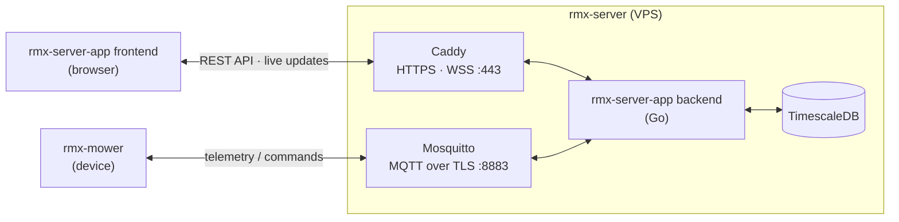

# Blade of Grass

An open source **robotic lawn mower** project: the mower, a cloud server it talks to, and a client app to watch and control it.

This wiki holds the project's knowledge. Work is planned in issues on the **[Blade of Grass project](https://github.com/orgs/rmx-lt/projects/1)**; the code lives in the [rmx-lt](https://github.com/rmx-lt) repos.

## Components

| Part | Repo | What it is | Wiki |
|---|---|---|---|
| **rmx-server** | [rmx-server-infra](https://github.com/rmx-lt/rmx-server-infra) | Server infrastructure: hardened Ubuntu VPS, Docker Compose, Caddy (HTTPS, secure WebSockets), Mosquitto (MQTT over TLS) | [Server-Infra](Server-Infra) · [Server-Infra-Ansible](Server-Infra-Ansible) |
| | [rmx-server-app-probe](https://github.com/rmx-lt/rmx-server-app-probe) | Learning / diagnostic Go service: a minimal MQTT → Postgres → HTTP/WSS stack that rehearses the backend toolchain and tests the server end to end | [Server-App-Probe](Server-App-Probe) |
| | [rmx-server-app](https://github.com/rmx-lt/rmx-server-app) | Production app: Go backend (telemetry ingest, TimescaleDB storage, REST/WebSocket API) and React/TypeScript frontend to monitor and control the mower | [Server-App](Server-App) |
| **rmx-mower** | [rmx-mower-autopilot](https://github.com/rmx-lt/rmx-mower-autopilot) | Mower firmware on the ESP32-P4 board: sensors, motion and blade control, safety | [Mower-Autopilot](Mower-Autopilot) · [Mower-Hardware](Mower-Hardware) |
| | [rmx-mower-gateway](https://github.com/rmx-lt/rmx-mower-gateway) | Comms firmware on the modem board: LTE, MQTT link to the server, link to the P4 | [Mower-Gateway](Mower-Gateway) · [Mower-Hardware](Mower-Hardware) |
| | [rmx-mower-gateway-probe](https://github.com/rmx-lt/rmx-mower-gateway-probe) | Learning / diagnostic firmware for the mower's LTE link: ESP32 + SIM7600G-H talking MQTT over TLS and HTTPS to the backend probe | [Mower-Gateway-Probe](Mower-Gateway-Probe) · [Mower-Gateway-Probe-Knowledge](Mower-Gateway-Probe-Knowledge) |

What is done, next and planned: the [project board](https://github.com/orgs/rmx-lt/projects/1).

## Architecture



- **Mower ↔ server:** MQTT over TLS. Each mower has its own login and may only use its own topics (`mower/<id>/…`): telemetry, online status (last will), commands and command acknowledgements.
- **Client ↔ server:** HTTPS for the REST API and the client app itself, plus secure WebSockets for live updates. Browsers never talk to the MQTT broker directly.
- **Inside the server:** every service runs in Docker. The database sits on an internal network that only the backend can reach.
- **Safety lives on the mower.** It stops by itself if the connection or command acknowledgements are lost, and never relies on the server to stop the blades.

## Public endpoints

| Endpoint | Protocol | Purpose |
|---|---|---|
| `https://rmx.lt` | HTTPS | Website / client app |
| `https://api.rmx.lt` | HTTPS, WSS | Backend API and live updates |
| `mqtt.rmx.lt:8883` | MQTT over TLS | Mower connections (login required) |

## Local layout

The component repos are cloned inside the blade-of-grass repo folder (its `.gitignore` excludes them):

```
blade-of-grass/            ← meta repo
├── rmx-server/
│   ├── rmx-server-infra/
│   ├── rmx-server-app/
│   └── rmx-server-app-probe/
└── rmx-mower/
    ├── rmx-mower-gateway/
    ├── rmx-mower-gateway-probe/
    └── rmx-mower-autopilot/
```

## Editing this wiki

Pages live in each repo's `wiki/` folder and change by pull request. The rules are in [Wiki-Policy](Wiki-Policy).

## Repo settings

Branch rulesets and `has_wiki` of every rmx-lt repo come from `tools/rulesets/` in blade-of-grass. Change the definitions there, run `python tools/rulesets/apply.py` (dry run), then `python tools/rulesets/apply.py --apply`. Organization rulesets would need GitHub Team.

## License

Code and documentation are licensed under [Apache-2.0](https://github.com/rmx-lt/blade-of-grass/blob/development/LICENSE).
